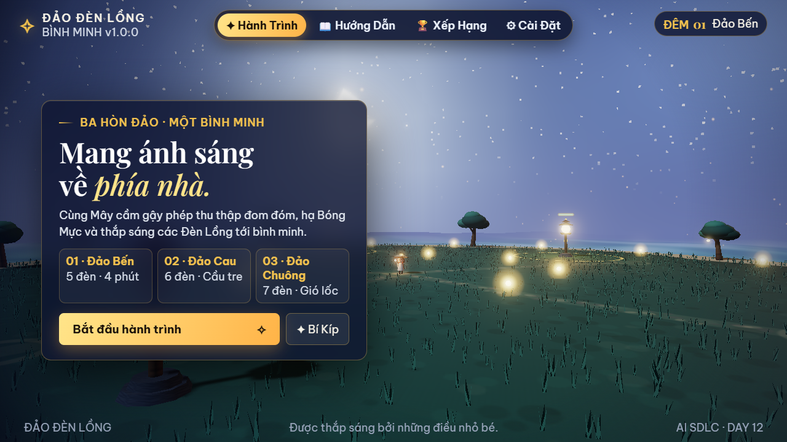

# Đảo Đèn Lồng · Bình Minh v1.0.0

Game 3D góc nhìn thứ ba — **Day 12 AI SDLC · Phase 4 / Test Contract v1.3**.  
Học viên: **Lê Sông Thao** · MSSV: **2A202603534**.

> **Video demo (< 5 phút):** Xem trực tiếp tại [`docs/demo/demo.mp4`](docs/demo/demo.mp4) hoặc tải kèm trong [GitHub Release v1.0.0](https://github.com/lesongthao/K5-L3A-DAY12-LeSongThao-2A202603534-AI-SDLC-Dao-Den-Long/releases/tag/v1.0.0).



Hành trình cùng bé Mây vượt qua ba hòn đảo giữa biển mây (**Đảo Bến**, **Đảo Cau**, **Đảo Chuông**), gom đom đóm, chiến đấu xua tan Bóng Mực hút dầu và Gió Lạc trộm sáng để giữ đảo rực sáng tới Bình Minh.

---

## 1. Cài Đặt & Chạy Nhanh (Tối đa 3 lệnh)

Yêu cầu môi trường: **Node.js >= 22.12.0**, `npm`, và trình duyệt hỗ trợ WebGL2.

### Cách 1: Chạy bản phát hành (3 lệnh chuẩn)
```sh
npm ci
npm run build
npm run preview
```
Mở trình duyệt tại địa chỉ hiển thị trên terminal (mặc định: `http://127.0.0.1:4173`). Âm thanh Web Audio bắt đầu ngay sau khi bấm **"Bắt đầu hành trình"**.

### Cách 2: Chạy môi trường phát triển (2 lệnh)
```sh
npm ci
npm run dev
```
Mở trình duyệt tại `http://127.0.0.1:5173`.

### Kiểm chứng tự động & Chế độ Headless CLI (Contract v1.3)
- Chạy toàn bộ bộ test đơn vị & contract (`94/94` tests):
```sh
npm test
```
- Chạy xác minh tổng hợp (build + tests + 18.000 ticks headless tất định + 7 feature scenarios + soak test):
```sh
npm run verify
```
- Chạy kiểm thử trình duyệt thật bằng Playwright (UI, điều hướng, 3 gậy/chiêu Q, chống chồng lấn HUD ở `1280×640`, 60 FPS):
```sh
npm run test:browser
```
- Chạy trực tiếp **Headless CLI** theo Test Contract v1.3:
```sh
npm run --silent headless -- --seed 42 --night 3 --ticks 18000 --snapshot-every 60 --out output.jsonl
```
*(Hỗ trợ đầy đủ `--scenario <file.json>`, `--inputs <file.json>`, và `--export-leaderboard <file.json>`; định dạng sai trả mã thoát `2` kèm thông báo ra `stderr`.)*

---

## 2. Bảng Điều Khiển & Phím Tắt

Hỗ trợ **Đổi phím tự do (Key Remapping)** cho cả 9 hành động trong tab **⚙ Cài Đặt** (phát hiện trùng phím, khôi phục mặc định và lưu qua `localStorage`):

| Thao tác | Phím mặc định | Mô tả chi tiết |
|---|---|---|
| **Di chuyển** | `W`, `A`, `S`, `D` / Mũi tên | Di chuyển tương đối theo hướng camera |
| **Xoay Camera** | Giữ chuột trái & kéo | Xoay góc nhìn 360° quanh Mây |
| **Nhảy** | `Space` | Nhảy vượt bậc đá / chướng ngại |
| **Lướt (Dash)** | `Shift` (Trái / Phải) | Lướt nhanh 2.8m trong 12 ticks, hồi chiêu 1.5s |
| **Đánh gậy phép** | Click chuột trái / `F` | Bé Mây vung gậy trăng khuyết; đánh trúng 3 gậy hạ 1 Bóng Mực (hồi sinh sau 20s) |
| **Tỏa sáng (Pulse)** | `Q` | Tiêu tốn 3 đom đóm: hạ gục ngay Bóng Mực trong tầm 5m (headless: đẩy lùi + làm choáng) |
| **Nạp / Châm dầu đèn** | `E` hoặc **Chuột phải** | Thắp đèn (10 đom đóm, thắp lại 5) hoặc châm dầu đèn đang sáng |
| **Tạm dừng / Tiếp tục** | `P` / `Escape` | Đóng băng mô phỏng (`simTick` dừng, `tick` vẫn tăng) |
| **Thu gọn chỉ dẫn / Ẩn HUD** | `I` / `H` | Bật/tắt khung hướng dẫn ngữ cảnh (`I`) hoặc ẩn HUD quay phim (`H`) |
| **Bí Kíp Ông Đăng** | `F9` (hoặc gõ `MAYVIP`) | Mở bảng chế độ tự do / đạo diễn (tắt hoàn toàn khi chạy test/headless/bench) |

---

## 3. Luật Chơi & Cơ Chế Cốt Lõi (Contract v1.3)

1. **Ba Hòn Đảo:**
   - **Đêm 1 · Đảo Bến (240s):** 5 đèn lồng, địa hình phẳng.
   - **Đêm 2 · Đảo Cau (270s):** 6 đèn lồng, hai bờ nối bằng cầu tre & bục nhảy không gian; xuất hiện Bùa Gió.
   - **Đêm 3 · Đảo Chuông (300s):** 7 đèn lồng, 3 tầng địa hình & dốc nghiêng; xuất hiện Gió Lạc và Gió lốc định kỳ.
2. **Nhiên liệu đèn & Đèn cạn dầu (`Ticket-03`):**
   - Đèn sau khi thắp có `100` nhiên liệu, tiêu hao `1.0 đơn vị/giây` (tính bằng số nguyên `fuelTicks` 1/60s).
   - Bấm `E` / Chuột phải để châm dầu (`1` đom đóm = `+10` dầu). Hết dầu đèn tắt (`lantern_out`), thắp lại (`ever_lit`) chỉ tốn `5` đom đóm (`relight_cost: 5`, `+40` điểm).
   - Khi `fuel < 30`, đèn mất vùng an toàn 6m và Bóng Mực `wander` sẽ tiến đến hút `5 dầu/giây` (`drain`). Đánh lui bằng Tỏa Sáng (`Q`) thưởng `+15` điểm.
3. **Điều kiện Thắng Bình Minh (`dawn_survived`):**
   - Hết thời gian Đêm, nếu Mây còn sống (`flames > 0`) và giữ được ít nhất `ceil(0.6 * N)` đèn đang sáng (`>= 3/5`, `>= 4/6`, `>= 5/7`), người chơi qua Đêm và cộng thưởng theo lượng dầu + Ngọn Lửa còn lại. Sức chứa túi tăng `+2` mỗi lần thắp đèn thành công (tối đa `20`).

---

## 4. Kết Quả Đo Lường Thực Tế (`Ticket-04`)

Đo trực tiếp trên cấu hình: **Intel Core i7-1270P**, **Windows 11 (`win32`)**, **Node.js `v26.13.1`**, trình duyệt Edge/Chromium WebGL (`1280×720`).

### Benchmark 30s (`bench.json` — Cảnh 200 Bóng Mực, 100 Đom đóm, tắt VSync)
| Chỉ số | Ngưỡng Contract v1.3 | Kết quả đo thật | Đánh giá |
|---|---:|---:|---|
| `avg_fps` | $\ge 60.0$ FPS | **242.0 FPS** | Đạt (vượt ngưỡng) |
| `p1_low_fps` | $\ge 30.0$ FPS | **121.6 FPS** | Đạt (vượt ngưỡng) |
| `frame_ms_p95` | $\le 33.3$ ms | **5.6 ms** | Đạt |
| `load_ms` | $\le 10000$ ms | **2149 ms** | Đạt |
| `frames` | — | **7261 frames** | Dùng GPU `InstancedMesh` |

Chạy lại Benchmark (tự mở preview server nếu chưa bật):
```sh
node scripts/bench.mjs --seed 42 --duration 30 --out bench.json
```

### Soak Test 10 Đêm liên tục (`soak.json`)
```sh
node scripts/soak.mjs --seed 7 --nights 10 --out soak.json
```
- **Số lần sập (`crashes`):** `0`
- **Bộ nhớ bắt đầu → kết thúc:** `53 MB` → `58 MB` ($\le 1.2 \times 53 = 63.6\text{ MB}$), thời gian chạy `0.3s`.

---

## 5. Trợ Năng & Bảng Xếp Hạng

- **Trợ năng:** Đổi đủ 9 phím điều khiển; Bảng màu tương phản cao (*Colorblind Mode*); Giảm chuyển động (*Reduced Motion*); Cỡ chữ chuẩn $\ge 18\text{px}$ ở `1280×720` kèm nút tăng cỡ chữ ($\times 1.25$); Cảnh báo thị giác & âm thanh (mũi tên hướng đèn tắt / Bóng Mực, gió giật, đèn yếu `< 30%`, đếm ngược 10 giây cuối).
- **Bảng xếp hạng Top 10:** Lưu tên `3–12` ký tự (`May_Vang`, `Ong_Dang`, ...), xem trong tab **🏆 Xếp Hạng**, hoặc xuất JSON từ CLI:
```sh
npm run preview -- --export-leaderboard out.json
```

---

## 6. Sáng Tạo Của Tôi (Creative Enhancements & Sandbox)

Toàn bộ tính năng sáng tạo được cách ly ở lớp trình duyệt (`src/browser/`) và **tự động tắt hoàn toàn** trong Headless CLI, `soak.mjs` và `?bench=1` để bảo toàn 100% tính tất định Test Contract:

1. **Chiến đấu Gậy Phép & Thanh Máu Bóng Mực (`combat.ts`, `models.ts`, `textures.ts`):**
   - Mỗi Bóng Mực có thanh máu 3 đốt đỏ ruby viền vàng ngay trên đầu; vung gậy 3 phát hoặc bấm `Q` (tốn 3 đom đóm) để hạ gục kèm hiệu ứng hạt ánh sáng nổ tan biến, và tự hồi sinh sau đúng 20 giây mô phỏng (`1200` ticks).
2. **Đồ họa PBR, GLSL Shader & Bé Mây Chibi (`shaders.ts`, `models.ts`, `vfx-combat.ts`):**
   - Bầu trời chuyển dần sang rạng đông trước bình minh, biển mây GLSL gợn sóng, đồng cỏ phản ứng theo hướng gió thực, vệt gậy trăng khuyết, dư ảnh khi lướt, Thuyền mây Ông Đăng & Đàn Hạc Giấy khi đạt ngưỡng Bình Minh (0 KB asset ngoài).
3. **Nhạc nền Ngũ Cung & Âm thanh Tổng hợp Web Audio (`ambience.ts`, `audio.ts`):**
   - Giai điệu ngũ cung hòa âm Delay Reverb kèm tiếng gió, tiếng côn trùng đêm, đom đóm ngân, tiếng bước chân trên cỏ và âm thanh vung gậy.
4. **Giao diện Tab trực quan, HUD chống chồng lấn & Chỉ dẫn Ngữ cảnh (`guide.ts`, `style.css`):**
   - Tổ chức lại Menu theo 4 Tab đầu trang, HUD dùng Flexbox theo vùng đảm bảo `0` cặp chồng lấn ngay cả ở khung `1280×640`, hộp chỉ dẫn động gợi ý đường đi nước bước từng tình huống, và bảng **Bí Kíp Ông Đăng** (`F9`) phục vụ thử nghiệm & quay demo (không ghi điểm Bảng xếp hạng khi đã kích hoạt cheat).

**Bằng chứng phần lõi vẫn chuẩn:** Sau mọi bổ sung sáng tạo, chạy `npm test` đạt `94/94` test case (`0` fail) và `npm run verify` đạt `passed: true` với 18.000 ticks headless giống hệt nhau từng byte (`output_sha256: 9496596...`) — xem chi tiết tại [`docs/proof/phase-4/README.md`](docs/proof/phase-4/README.md).

---

## 7. Tài Liệu Dự Án & Quy Định Lab

- **Tài liệu quy chuẩn gốc của Lab:** [GUIDE.md](GUIDE.md) · [RULES.md](RULES.md) · [RUBRIC.md](RUBRIC.md) · [CHECKPOINTS.md](CHECKPOINTS.md) · [SUBMISSION.md](SUBMISSION.md)
- **Kiến trúc & Đặc tả theo Phase:** [ARCHITECTURE.md](docs/ARCHITECTURE.md) · [PRD.md](docs/PRD.md) · [PHASE2.md](docs/PHASE2.md) · [PHASE3.md](docs/PHASE3.md) · [PHASE4.md](docs/PHASE4.md) · [ADR-003](docs/adr/003-fuel-decay-and-win-condition.md)
- **Nhật ký, Thay đổi & Hồi tưởng:** [CHANGELOG.md](docs/CHANGELOG.md) · [ai-log.md](docs/notes/ai-log.md) · [test-changes.md](docs/notes/test-changes.md) · [review.md](docs/notes/review.md) · [retro.md](docs/notes/retro.md)
- **Bản quyền & Harness AI:** [LICENSE](LICENSE) · [CREDITS.md](CREDITS.md) · [AGENTS.md](AGENTS.md) · [verify-game Skill](.agents/skills/verify-game/SKILL.md) · [CI Workflow](.github/workflows/verify.yml)
